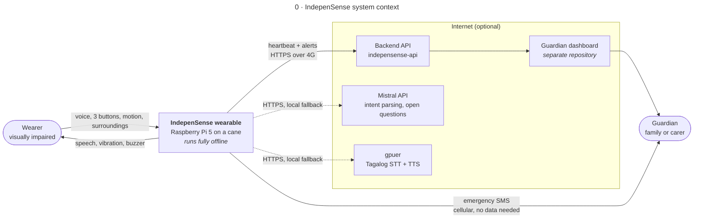
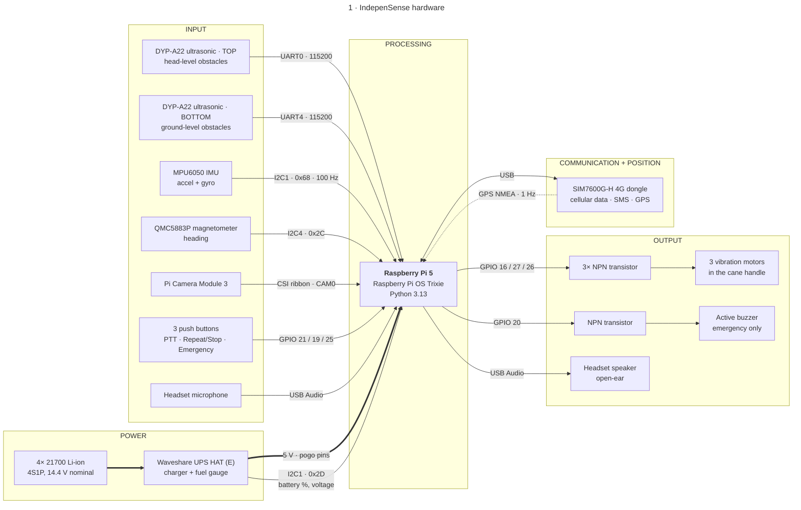
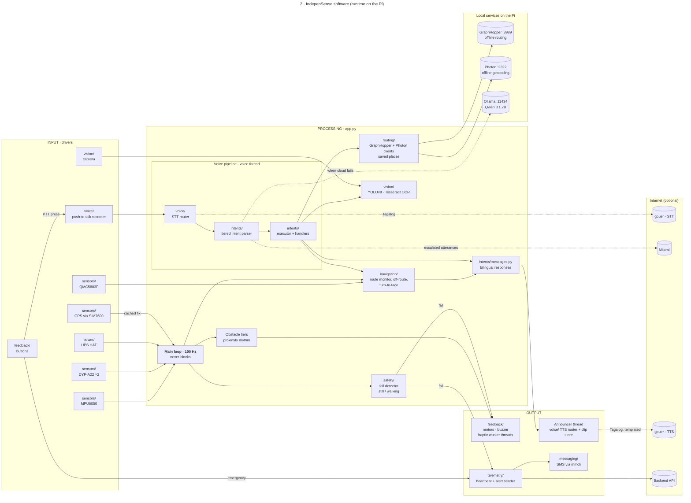

# IndepenSense — Block Diagrams

What the system is made of and how its parts connect. [`flowchart.md`](flowchart.md) shows *when* things happen. These diagrams show *what talks to what*.

## How to read these

The diagrams are **levelled**, like the flowcharts. Each one zooms into a block of the one above it:

| Level | Diagram | Shows |
|---|---|---|
| 0 | [System context](#0-system-context) | The wearable as one block, with the people and services it talks to |
| 1 | [Hardware](#1-hardware-block-diagram) | Every physical component, the bus it sits on, and how power reaches it |
| 2 | [Software](#2-software-functional-block-diagram) | The runtime's domains, grouped into input, processing and output |

Every diagram reads **left to right: input → processing → output**. Arrow labels name the interface: a bus, a protocol, or the data that crosses it.

| Arrow | Meaning |
|---|---|
| Solid | Data or control, every time the system runs |
| Thick | Power |
| Dotted | Optional path. Cloud services with a local fallback, or a fallback used only when the primary path fails |

Pins, addresses and ports match [`hardware.md`](hardware.md) and `config.py` as of this commit. `hardware.md` stays the single source of truth for wiring. If the two disagree, this file is the one that is wrong.

---

## 0 System context

The wearable is one block here. Everything outside it is a person or a service it depends on.

**Why the cloud box is dotted.** Every remote stage has a local fallback, and routing and geocoding run on the Pi itself (GraphHopper, Photon). With no network the device still detects falls and obstacles, navigates and speaks. Only two things need the network: guardian telemetry, and the open-question answerer. Alerts also go by SMS, which needs cellular signal but no data bearer. See [`cloud-services.md`](cloud-services.md).

---

## 1 Hardware block diagram

The wearable from level 0, broken into physical components. The Pi sits in the middle, inputs are on the left, outputs on the right, and power is below.

**Design decisions this diagram shows:**

- **Two I²C buses.** The compass has I2C4 to itself. On I2C1 its third set of pull-ups made the bus unreliable. See [`hardware.md` → Why its own bus](hardware.md#why-its-own-bus).
- **Transistors between the GPIO and every motor or buzzer.** Each motor draws 60–100 mA, well above what a GPIO pin can source.
- **Microphone and speaker are one USB device.** The Pi 5 has no 3.5 mm jack. A USB Audio Class headset is full duplex, which the Bluetooth earphones it replaced were not.
- **The 4G dongle is on USB, not a HAT.** The 40-pin header is fully used, and a HAT would cover it.
- **The UPS HAT uses no header pins.** It powers the Pi through pogo pins underneath and shares only I2C1.
- **The three motors are drawn as one output.** They are mounted in the same handle, so the wearer feels one vibrator with three intensity steps, not three directions.

---

## 2 Software functional block diagram

The Raspberry Pi block from level 1, broken into the runtime's domains (`src/indepensense/<domain>/`). Each block names its module. Drivers are drawn with their hardware. Everything else is application logic that depends only on a driver's `Protocol`, never on the driver itself.

**What this diagram shows:**

- **The main loop only reads and decides.** Speech goes to the announcer thread and haptic patterns to short-lived worker threads, so fall and obstacle detection never wait on output. This is the concurrency rule in the `app.py` module docstring.
- **Voice runs on its own thread.** A push-to-talk press starts it, so transcription and inference (seconds) never touch the 100 Hz loop.
- **Intent parsing is three-stage.** An on-device embedding matcher answers about 52% of utterances in about 30 ms. The rest go to Mistral, and Ollama is used only when the cloud fails.
- **Every spoken word passes through `messages.py`.** No user-facing text lives in the logic blocks. That is what keeps English and Tagalog in step.
- **Every dotted arrow to the internet has a local block beside it.** Ollama backs Mistral. Local Whisper and Piper/MMS (inside the STT and TTS routers) back gpuer. GraphHopper and Photon never needed the cloud at all.
- **An alert leaves by two paths.** HTTPS to the backend for the dashboard, and SMS for when there is signal but no data.
