# IndepenSense — Program Flowcharts

How the wearable runtime (`src/indepensense/app.py`) behaves, from power-on to shutdown.

## How to read these

The program is **not one linear sequence**. A 100 Hz sensor loop runs continuously while button presses, the voice pipeline and several background workers run beside it (see the concurrency model at the top of `app.py`). A single flowchart cannot show that without either hiding the concurrency or becoming unreadable. The charts are therefore **levelled**: one main program that calls sub-processes, which in turn call their own.

The charts are linked by the **predefined process** symbol (ISO 5807), drawn as a box with double vertical edges, `[[ ]]`. It means "run the process defined in the chart with this name, then continue from here". Three rules make every link unambiguous:

1. **The calling box carries the sub-chart's number and name**, e.g. `2.1 Fall detection` inside chart 2.
2. **The sub-chart's first symbol is a terminator with the same number and name.** It does not start with a generic "Start".
3. **The sub-chart ends in `Return`**, which hands control back to the box that called it. Only the main program (chart 0) has a true `End`.
4. **Every chart has a single entry and a single exit.** All paths converge on one exit terminator. A failure leads to its own step first, then joins that exit, rather than ending on a terminator of its own.

The whole program therefore has exactly one **Start** (power on) and one **End**, both in chart 0. The terminators in the sub-charts are not starts and ends: they mark where control enters the sub-process and where it returns to its caller.

The numbering is decimal by level, so a chart's number names its caller: **2.1** is called from **2**, and **3.2.1** from **3.2**. Two charts are shared and called from several places, so they sit at level 1 rather than under one parent. **4 Emergency alert** is started by the button, a fall, or a voice command. **6 Speech output** is used by everything that speaks.

Every chart is titled with its number and feature, and each section names the function in the code that implements it.

| Symbol | Meaning |
|---|---|
| Rounded ends | Terminator: the program's start/end, a sub-chart's entry, or `Return` |
| Rectangle | Process step |
| Diamond | Decision |
| Parallelogram | Input / output: sensor read, tone, button wait, network |
| Double-edged rectangle | Predefined process: call the chart with this number |
| Dotted arrow | Starts a separate thread, or calls a shared chart |

Thresholds shown are the current `config.py` values.

---

## Call hierarchy

Which chart calls which. Solid arrows run from a parent to its own sub-charts. Dotted arrows are calls into a shared chart, or the start of a new thread.

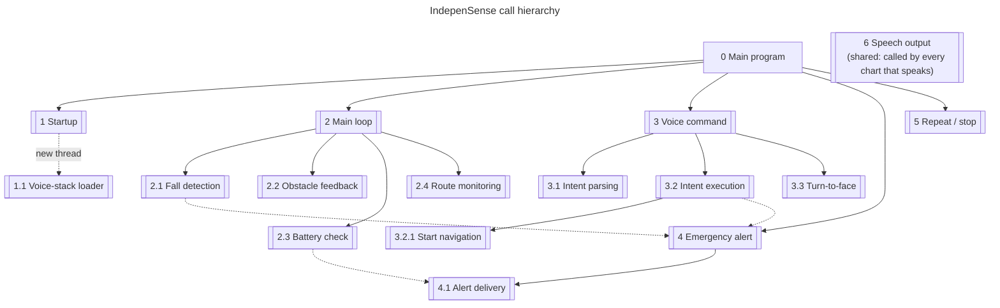

| Chart | Implemented in | Called by | Calls |
|---|---|---|---|
| [0 Main program](#0-main-program) | `app.py`: `run_app()` | — | 1, 2, 3, 4, 5 |
| [1 Startup](#1-startup) | `app.py`: `App.start()` | 0 | 1.1 (new thread) |
| [1.1 Voice-stack loader](#11-voice-stack-loader) | `app.py`: `App._load_voice_stack()` | 1 | 6 |
| [2 Main loop](#2-main-loop) | `app.py`: `App.run()` | 0 | 2.1, 2.2, 2.3, 2.4 |
| [2.1 Fall detection](#21-fall-detection) | `safety/fall_detector.py`: `ThresholdFallDetector.process()` | 2 | 4 |
| [2.2 Obstacle feedback](#22-obstacle-feedback) | `app.py`: `App._check_obstacle_sensor()`, `App._tick_obstacle_rhythm()` | 2 | — |
| [2.3 Battery check](#23-battery-check) | `app.py`: `App._check_battery_and_alert()` | 2 | 4.1, 6 |
| [2.4 Route monitoring](#24-route-monitoring) | `app.py`: `App._check_navigation()` → `navigation/monitor.py`: `NavigationMonitor.check()` | 2 | 6 |
| [3 Voice command](#3-voice-command) | `app.py`: `App._on_ptt_press()` → `App._voice_pipeline()` | 0 | 3.1, 3.2, 3.3, 6 |
| [3.1 Intent parsing](#31-intent-parsing) | `intents/tiered.py`: `TieredIntentParser.parse()` | 3 | — |
| [3.2 Intent execution](#32-intent-execution) | `intents/executor.py`: `IntentExecutor.execute()` | 3 | 3.2.1, 4 |
| [3.2.1 Start navigation](#321-start-navigation) | `intents/executor.py`: `IntentExecutor._handle_navigation_start()` | 3.2 | 6 |
| [3.3 Turn-to-face](#33-turn-to-face) | `app.py`: `App._orient_towards_route()` | 3 | 6 |
| [4 Emergency alert](#4-emergency-alert) | `app.py`: `App._on_emergency_press()`, `App._on_fall_detected()`; `intents/executor.py`: `IntentExecutor._handle_emergency_trigger()` | 0, 2.1, 3.2 | 4.1, 6 |
| [4.1 Alert delivery](#41-alert-delivery) | `telemetry/sms_alerts.py`: `SMSAlertNotifier.send_alert()` | 4, 2.3 | — |
| [5 Repeat / stop](#5-repeat--stop) | `app.py`: `App._on_repeat_press()` | 0 | 6 |
| [6 Speech output](#6-speech-output) | `app.py`: `App._announce()` → `Announcer`, `App._play_clip()`, `App._clip_for_text()` | 1.1, 2.3, 2.4, 3, 3.2.1, 3.3, 4, 5 | — |

---

## 0 Main program

**Implemented in:** `app.py`: `run_app()`, which calls `App.start()` and then `App.run()`.

The whole program on one page. After startup, the main loop and the button handlers run at the same time. The buttons are gpiozero callbacks, so a press never waits for the loop.

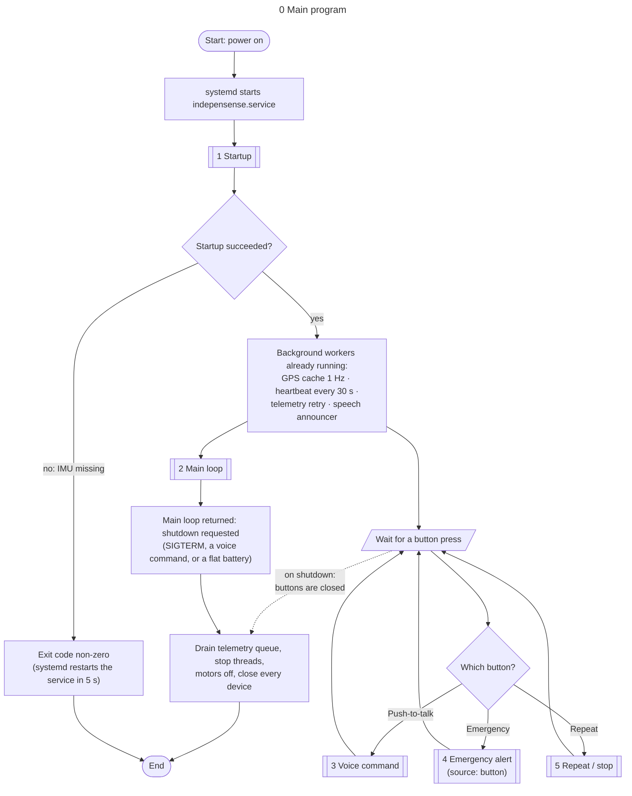

---

## 1 Startup

**Implemented in:** `app.py`: `App.start()`.

Opens only what fall detection, obstacle warnings and the emergency alert need, then returns. The models take about 200 s to load from the SD card and none of the safety features needs them, so they load on a separate thread (1.1) while the main loop is already running.

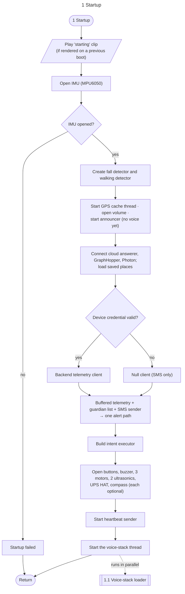

### 1.1 Voice-stack loader

**Implemented in:** `app.py`: `App._load_voice_stack()` → `App._load_voice_stack_once()` → `App._warm_up_nlu()`.

Runs on its own thread. If the models cannot be loaded, the device stays up in safety-only mode instead of crashing. A crash would trigger a systemd restart loop, which would take fall detection down with it.

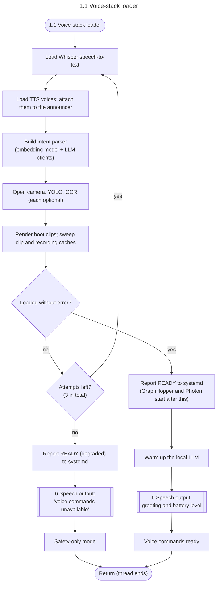

---

## 2 Main loop

**Implemented in:** `app.py`: `App.run()`.

Runs 100 times a second until shutdown. Nothing here may block: any speech goes to the announcer queue (6), and motor pulses run on their own short-lived threads.

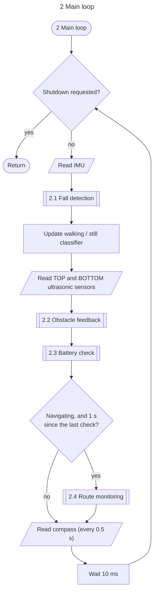

### 2.1 Fall detection

**Implemented in:** `safety/fall_detector.py`: `ThresholdFallDetector.process()`; a confirmed fall is handled by `app.py`: `App._on_fall_detected()`.

A state machine that takes one IMU sample per tick. A fall is confirmed by either of two routes: **free-fall then impact**, or a **hard impact followed by a large change in posture**. The second route catches falls that have no clean free-fall phase.

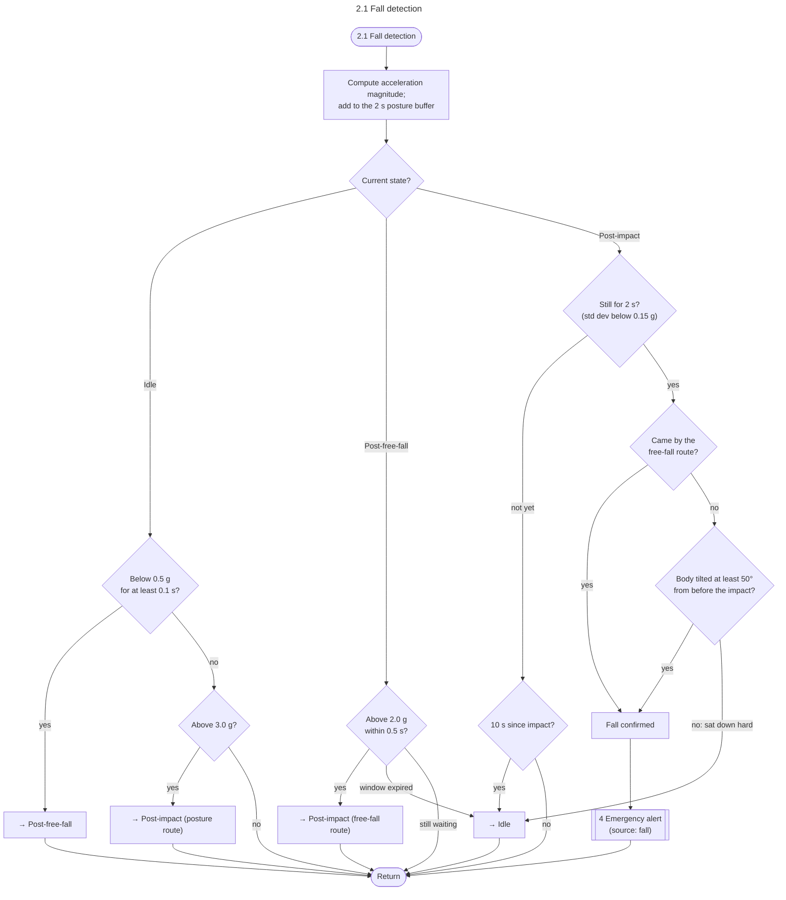

### 2.2 Obstacle feedback

**Implemented in:** `app.py`: `App._check_obstacle_sensor()` (once per sensor), then `App._tick_obstacle_rhythm()`, which uses `_obstacle_feedback()`.

Feedback is haptic only; the buzzer is reserved for emergencies. The three motors share one handle and feel like a single vibrator, so distance is expressed as **pulse rate and strength**, never as direction.

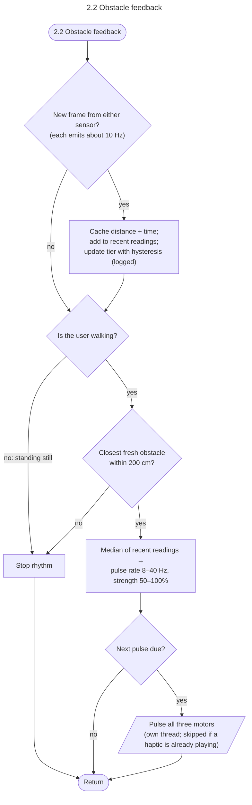

### 2.3 Battery check

**Implemented in:** `app.py`: `App._check_battery_and_alert()`; the power-off tier hands over to `App._begin_low_battery_shutdown()`.

There are three tiers, each with its own latch, so a level hovering at a threshold does not repeat the warning. The low and critical latches are saved to disk, so a reboot does not re-warn about the same discharge.

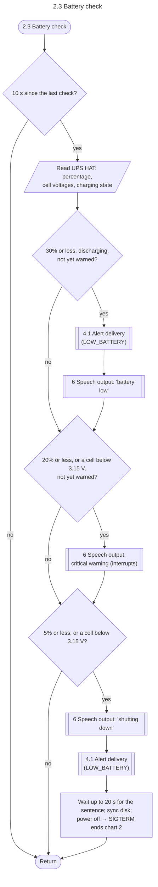

### 2.4 Route monitoring

**Implemented in:** `app.py`: `App._check_navigation()` → `navigation/monitor.py`: `NavigationMonitor.check()`; cues are spoken by `App._fire_navigation_cue()`.

Polled about once a second while a route is active. There is **no automatic reroute**: leaving the route produces a spoken warning only.

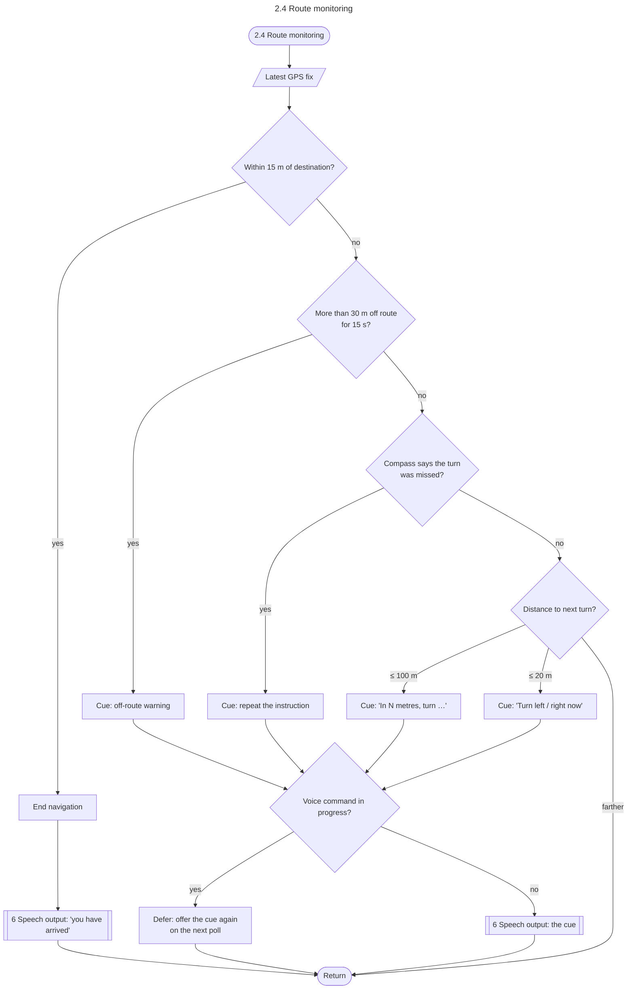

---

## 3 Voice command

**Implemented in:** `app.py`: `App._on_ptt_press()` (the checks), then `App._voice_pipeline()` on the voice thread.

Started by a push-to-talk press and run on its own thread. Pressing **Emergency** or **Repeat** at any point abandons the command: every stage checks a shared cancel flag and returns.

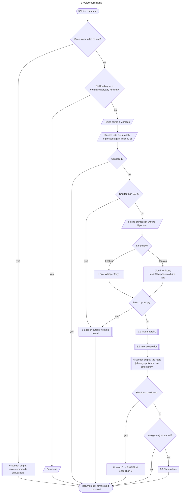

### 3.1 Intent parsing

**Implemented in:** `intents/tiered.py`: `TieredIntentParser.parse()` (embedding tier), then `intents/fallback.py`: `FallbackIntentParser.parse()` (cloud, then local).

Three tiers, and a command only reaches the tiers it needs. The first tier answers about half of all commands on the device in about 30 ms. The embedding match never answers an intent with a free-text slot, such as a destination, because it cannot extract the slot.

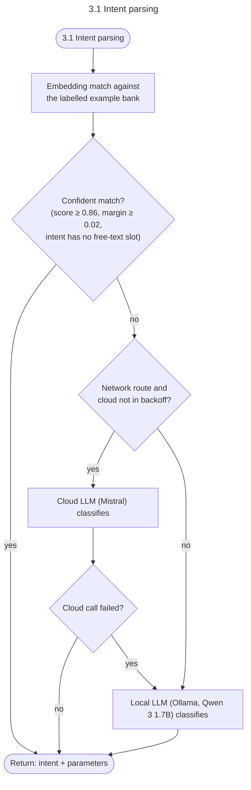

### 3.2 Intent execution

**Implemented in:** `intents/executor.py`: `IntentExecutor.execute()`, which dispatches to one `_handle_<intent>()` method per intent.

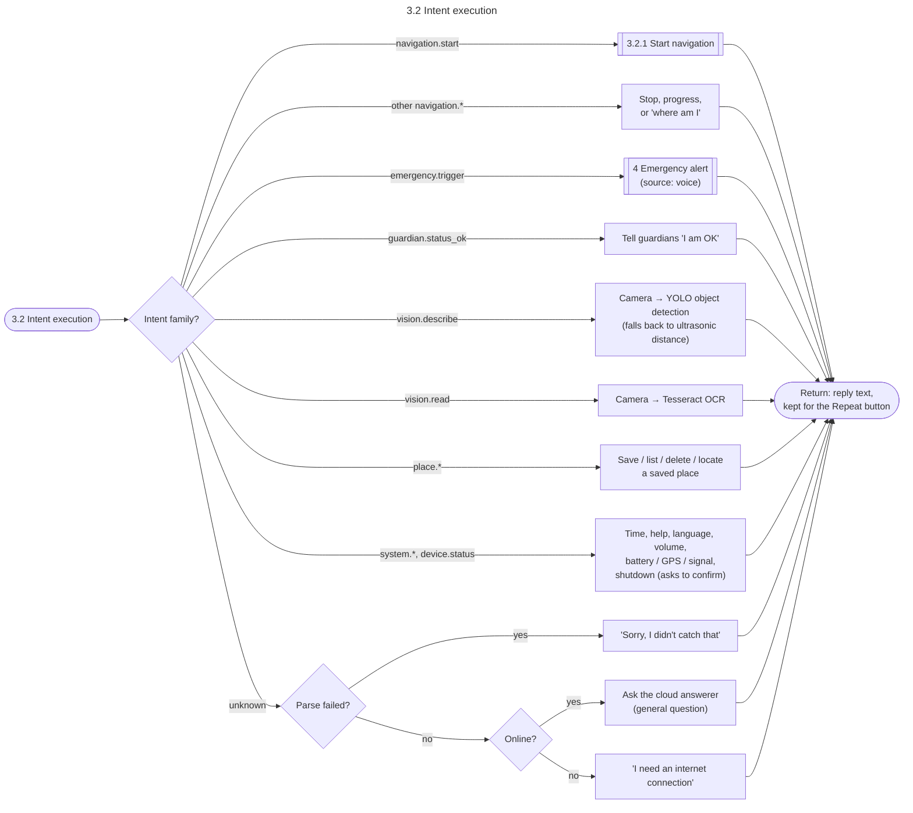

### 3.2.1 Start navigation

**Implemented in:** `intents/executor.py`: `IntentExecutor._handle_navigation_start()`; the yes/no question is `app.py`: `App._confirm_destination()`.

Runs inside intent execution, on the voice thread. Once a route is set, chart 2.4 follows it from the main loop.

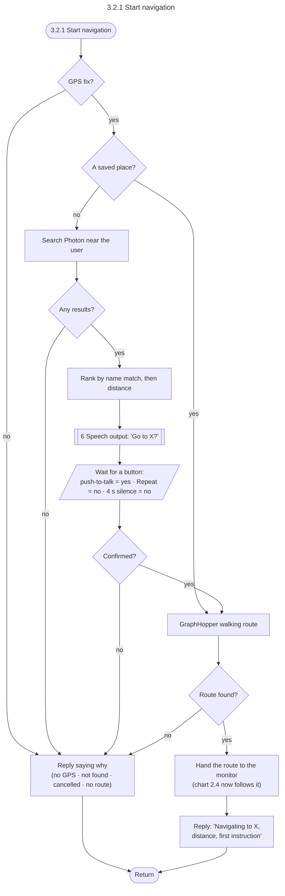

### 3.3 Turn-to-face

**Implemented in:** `app.py`: `App._orient_towards_route()`, using `navigation/orientation.py`: `OrientationGuide.cue()`.

Turns the user towards the start of the route before they take a step. It is inactive until the compass has been calibrated on the assembled unit.

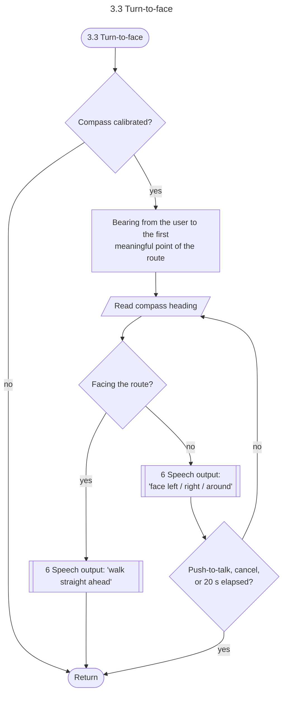

---

## 4 Emergency alert

**Implemented in:** one entry point per source, all ending in the same alert path:

- button: `app.py`: `App._on_emergency_press()`
- fall: `app.py`: `App._on_fall_detected()`
- voice: `intents/executor.py`: `IntentExecutor._handle_emergency_trigger()`

The spoken outcome is `app.py`: `App._on_alert_delivery()`.

There are three ways in, and all of them use the same delivery path. The buzzer sounds only here: it is the one output a bystander can perceive, so it carries a single meaning.

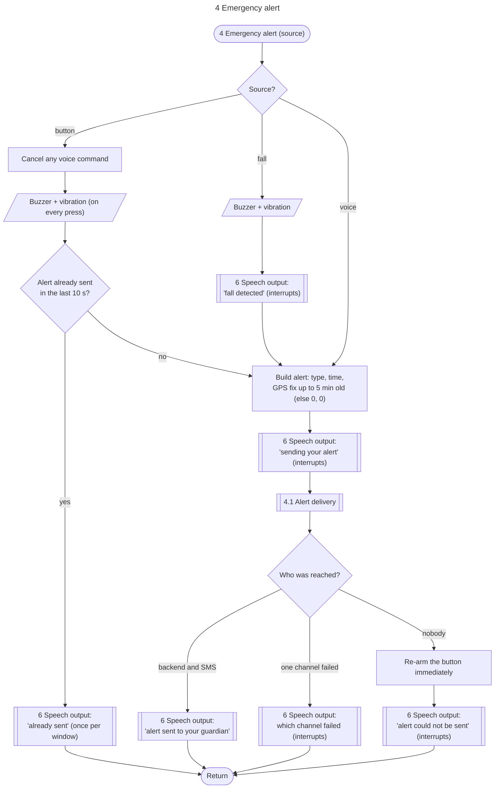

### 4.1 Alert delivery

**Implemented in:** `telemetry/sms_alerts.py`: `SMSAlertNotifier.send_alert()`, wrapping `telemetry/buffered.py`: `BufferedTelemetryClient.send_alert()`.

Used by every guardian alert: emergency, fall and low battery. The caller does not wait on the network, because both legs run on worker threads. The outcome is reported back within about 30 s. Only emergency and fall alerts have their outcome spoken.

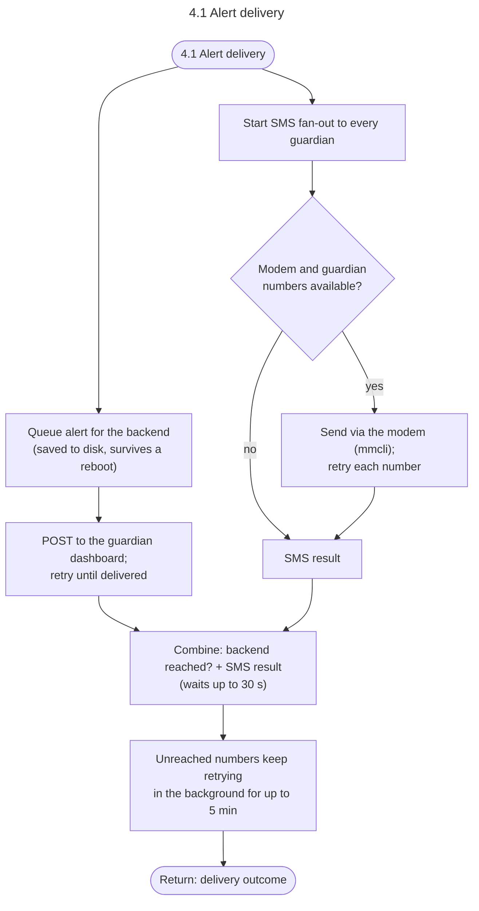

---

## 5 Repeat / stop

**Implemented in:** `app.py`: `App._on_repeat_press()`.

One button with two companion meanings, both about the last thing the device said.

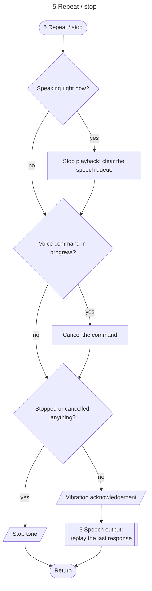

---

## 6 Speech output

**Implemented in:** `app.py`: `App._announce()` → `Announcer` (main loop and background threads); `App._play_clip()` and `App._clip_for_text()` (voice thread); file naming and lookup in `voice/clips.py`.

Shared by every chart that speaks. Speech raised on the main loop or a background thread goes through the **announcer** queue, so the loop never waits on audio. The voice thread plays its own speech directly.

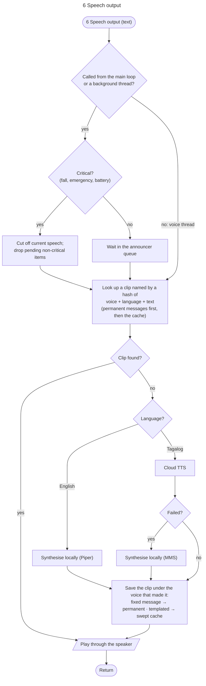
